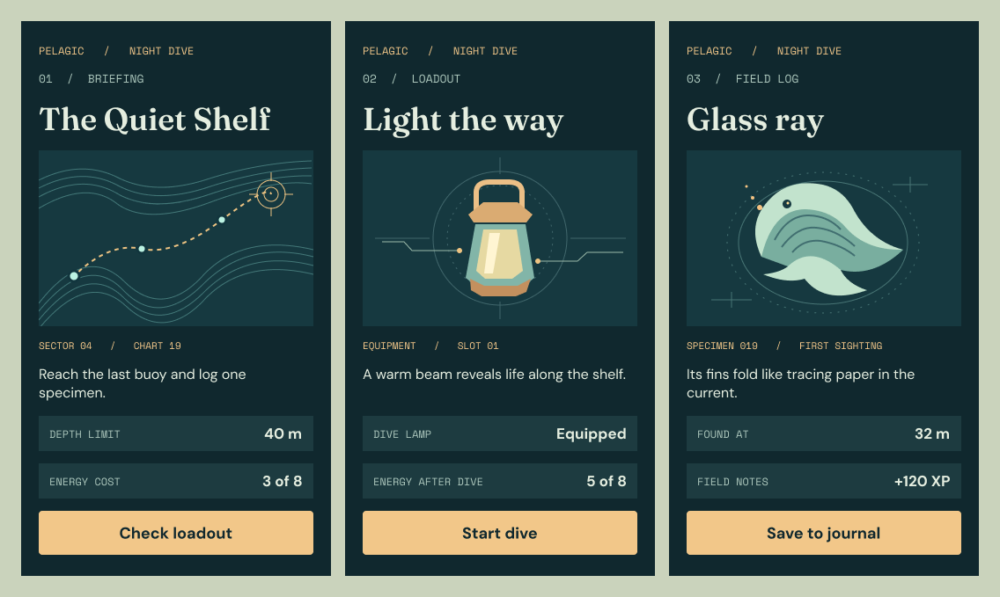

# Pelagic · Night Dive

Небольшой кейс по игровым интерфейсам. В ночном море игрок ищет стеклянного ската. Перед погружением нужно понять две вещи: куда плыть и хватит ли энергии на выход. После — записать находку в журнал.

[Пройти погружение в браузере](https://german4341374.github.io/pelagic-game-ui/) · [Открыть макет в Figma](https://www.figma.com/design/0zTtHatrP5nCdKeuzLlirf/Pelagic?node-id=2-13) · [Скачать SVG](art/) · [Увеличить превью](night-dive.png)

### Что здесь можно посмотреть

1. **Маршрут.** Пунктир ведёт к последнему бую. Под картой указаны глубина и цена погружения: 3 единицы из имеющихся 8.
2. **Снаряжение.** Фонарь уже выбран. До старта видно остаток энергии — 5 из 8. Это последнее окно, где можно выйти без списания.
3. **Находка.** На первом плане силуэт ската. Глубина и награда ниже: их легко считать, но они не спорят с иллюстрацией.

### Как устроен макет

У всех трёх окон один каркас шириной 352 px. Основная кнопка высотой 50 px остаётся на том же месте, даже если описание занимает две строки. Тёплый жёлтый отмечает главное действие, название находки набрано Fraunces, обычный текст — DM Sans, приборные подписи — Space Mono. Состояния передаются словами и числами, а не только цветом.

В Figma текст можно редактировать. Кнопка и строки показаний — экземпляры общих компонентов. Для вёрстки карта, фонарь и скат вынесены в отдельные [SVG](art/) с одинаковым размером 312 × 200. Браузерный вариант использует системные шрифты и работает без загрузок.

### Попробовать сценарий

Скачайте репозиторий через **Code → Download ZIP**, распакуйте и откройте `index.html`. Ничего устанавливать не нужно. Проверьте возврат со снаряжения, затем начните погружение и сохраните запись. Повторный выход расходует энергию; когда её не хватит, появится объяснение. Обновление страницы начинает сеанс заново.

Учебный концепт для вымышленной игры, не заказ студии. Это один короткий игровой цикл без симуляции погружения, платежей и аккаунтов.
